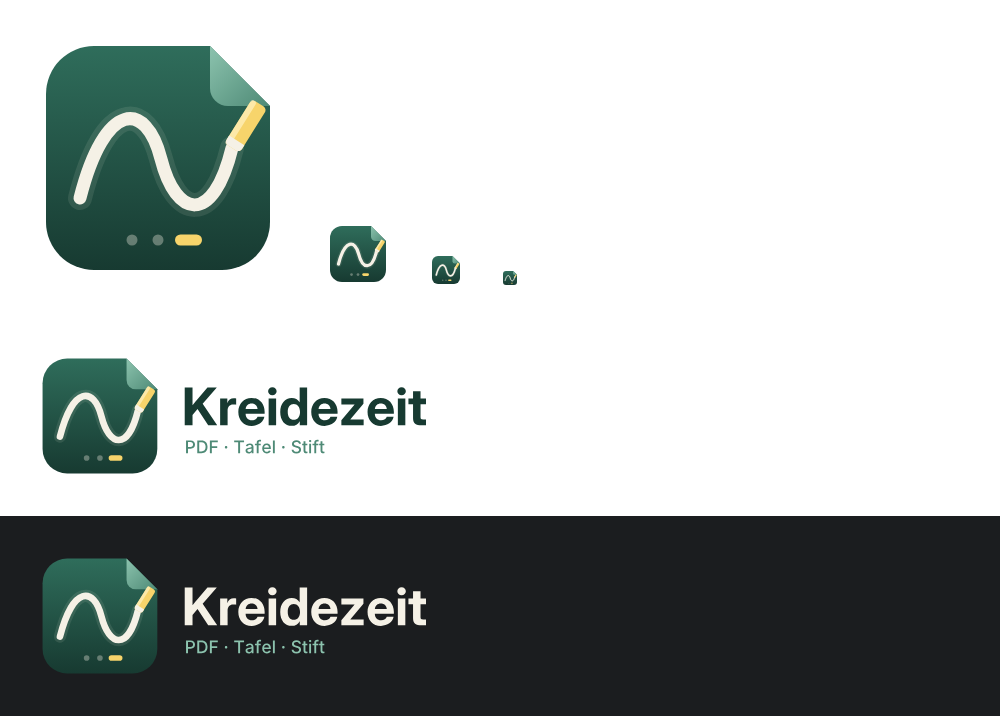

# Branding – Vorschlag „Kreidezeit“

| Datei | Verwendung |
|---|---|
| `icon.svg` | App-Icon (512 × 512, ohne Filter – auch für Svg.Skia/Avalonia geeignet) |
| `logo.svg` | Icon + Schriftzug für helle Hintergründe |
| `logo-dark.svg` | Icon + Schriftzug für dunkle Hintergründe |

Der Schriftzug ist als Pfad eingebettet (Inter Display Bold / Inter Medium), braucht also keine
installierte Schrift.

Motiv: eine Tafel in Form einer PDF-Seite mit Eselsohr, darauf ein Funktionsgraph in Kreide, am
Ende das Kreidestück; unten die Folien-Fortschrittsanzeige (aktuelle Folie gelb).

Farben: Tafelgrün `#2F6D5B` → `#173A31`, Kreide `#F5F1E6`, Kreidegelb `#F7D46B`,
Akzentgrün `#8CC3AE` / `#4E8A76`.
