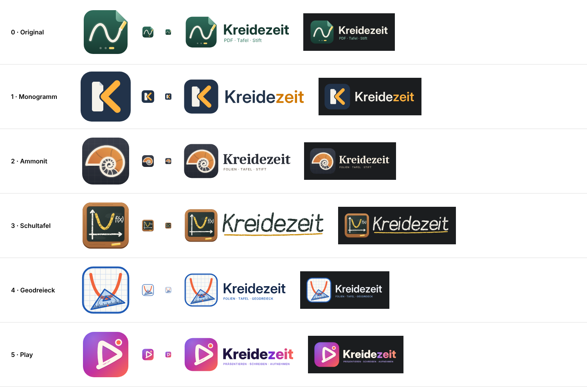

# Logo-Alternativen für „Kreidezeit“

| Nr. | Richtung | Kurzbeschreibung |
|---|---|---|
| 0 | Original (`../`) | Grüne Tafel als PDF-Seite mit Eselsohr, Funktionsgraph in Kreide, Folienpunkte |
| 1 | [Monogramm](01-monogramm) | „K“ aus PDF-Seite (Stamm) und gelbem Kreidestrich (Arme), Schiefer/Gelb |
| 2 | [Ammonit](02-ammonit) | Ammonit (Leitfossil der Kreidezeit) als logarithmische φ²-Spirale auf Schiefertafel |
| 3 | [Schultafel](03-schultafel) | Tafel im Holzrahmen mit Achsen, Parabel und f(x), handgezeichnete Wortmarke |
| 4 | [Geodreieck](04-geodreieck) | Transparentes Geodreieck auf Karopapier, Parabel scheint durch, hell/blau |
| 5 | [Play](05-play) | Play-Dreieck aus einem Kreidestrich mit REC-Punkt, Violett-Koralle-Verlauf |

Jeder Ordner enthält `icon.svg` (512 × 512, ohne Filter/Text), `logo.svg`, `logo-dark.svg`,
`concept.md` (Konzept, Farben, Schrift) und `preview.png`.
